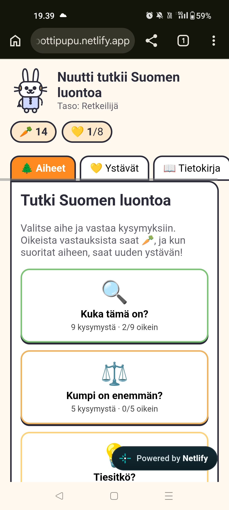
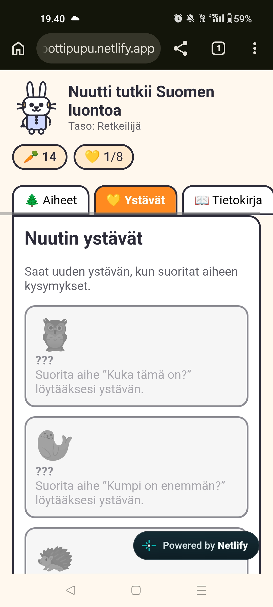

# Nuutti tutkii Suomen luontoa

Pelillinen tietosovellus robottipupu Nuutista. Nuutin tehtävä: kerätä porkkanoita, hankkia ystäviä ja oppia suomalaisesta luonnosta.

## Kuvat
| Aiheet | Ystävät |
|---|---|
|  |  |

## Pelaaminen
Avaa `index.html` selaimessa (ei asennusta). Edistyminen tallentuu selaimen localStorageen.

- **Aiheet**: kahdeksan aihetta (tunnistaminen, vertailut, yllättävät faktat, ekologia, myytit, kartta, jokamiehenoikeudet, perinne). Oikeasta vastauksesta saa 🥕, ja jokaisen vastauksen jälkeen näytetään selitys.
- **Ystävät**: jokaisen aiheen suorittamisesta saa suomalaisen eläinystävän.
- **Tietokirja**: kerää kaikki oppimasi faktat. Nuutin taso nousee porkkanoiden mukana.

## Kysymystyypit
Monivalinta (myös siluettikuva ja äänikuvaus), "Kumpi on enemmän?", järjestäminen pienimmästä suurimpaan, totta vai tarua sekä Suomen kartan klikkaus.

## Sisällön lisääminen
Kaikki aiheet, kysymykset ja ystävät ovat tiedostossa `data.js`. Kysymystyypit on selitetty tiedoston alussa.

## Testit
`node tests/game.test.js` (vaatii playwrightin) tarkistaa datan ja pelaa kaikki aiheet läpi usealla näytön koolla.

## Kokoonpano ja työkalut
- **Kielet**: vanilla HTML (`index.html`), CSS (`style.css`) ja JavaScript (`app.js`, `data.js`). Ei kehys- tai kirjastoriippuvuuksia eikä build-vaihetta.
- **Tallennus**: selaimen localStorage.
- **Media**: kuva (`assets/nuutti.jpg`) ja ääninäytteet (`assets/*.mp3`).
- **Testit**: Node.js + Playwright (Chromium), `tests/game.test.js`.
- **Julkaisu**: Netlify (staattinen sivusto, esim. robottipupu.netlify.app).
